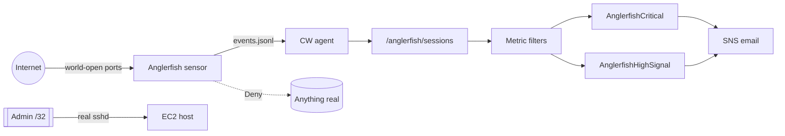

# Anglerfish

A multi-service deception sensor. It looks like a small organisation's
internal NAS and deploy host; anyone who digs in finds planted credentials and
canary files. Taking the bait *is* the detection.

Built by **DhWonder** with red-team and blue-team AI assistants.

> Named for the deep-sea fish that lures prey with a lit appendage — the payoff
> is the trap.

## What it emulates

| Facade | Looks like |
|---|---|
| SSH | OpenSSH 8.9p1 on Ubuntu (real handshake, HASSH fingerprint, fake shell) |
| HTTPS / HTTP | nginx/1.18 + Synology DSM login SPA + sandboxed File Station |
| FTP | vsftpd 3.0.5 |
| SMTP | Postfix on Ubuntu |
| Telnet | Busybox-ish banner (Mirai food) |

One coherent persona per install: hostname, company, domain, NAS model,
banners, planted logins, bait tree. Identity comes from a YAML file **you**
own; host keys, TLS cert and planted passwords are minted at first run.

## Architecture



**Hard line:** bait may be taken; there is no path to anything real.
Instance role Deny outside `/anglerfish/*`, IMDSv2 hop limit 1, no real
credentials on the box.

## Quick start (local)

```bash
# 1. Pick a persona (do this before any public deploy)
cp config/persona.example.yaml config/persona.yaml
$EDITOR config/persona.yaml          # change EVERY value

# 2. High ports, loopback — no root needed
python3 anglerfish_cli.py sensor \
  --bind 127.0.0.1 \
  --ports 2222 8080 8443 2121 2525 2323 \
  --persona config/persona.yaml \
  --state-dir ~/.anglerfish-dev

# 3. In another terminal
curl -sk https://127.0.0.1:8443/ | head
nc -v 127.0.0.1 2222                # SSH banner
```

Planted passwords are printed once at first mint (and saved under the state
dir). They are random; the repo contains none.

```bash
python3 -m unittest discover -s tests -v     # or: for t in tests/test_*.py; do python3 $t; done
```

## Detection (Blue Team half)

Structured JSON events (`docs/log-schema.md`) ship off-host via the CloudWatch
agent. Two roll-up metrics keep you inside the always-free tier:

| Metric | Fires on | Default alarm |
|---|---|---|
| `AnglerfishCritical` | planted/`auth_ok`, bait `path_read` (R1b), org-themed cred guess | SNS, 5-min, threshold 1 |
| `AnglerfishHighSignal` | Synology webapi, FTP dialogue past USER/PASS, forged sid/token | SNS, 1h, threshold 5 |

Full rule table: [`docs/detection-rules.md`](docs/detection-rules.md) (R1–R11).

## Containment model

| Control | How |
|---|---|
| No real secrets on the box | Planted passwords minted per install; canaries are fake AWS keys / URLs |
| No lateral movement | Sensor UID egress-guarded from IMDS, admin port, VPC (optional script) |
| No IMDS creds via SSRF | IMDSv2 required, hop limit **1** |
| No useful IAM | Instance role Deny for SSM/S3 outside `/anglerfish/*` |
| Admin SSH locked | Non-22 port, `AdminCidr` /32 only; honeypot ports stay world-open |
| Sandboxed payoff | File Station + fake shell serve bait only; never exec attacker input |

## Cost

Roughly **~$1/mo** on a small EC2 (t3.micro/nano) with CloudWatch Logs
(30-day retention) and two alarms. Metric filters are free. No managed
WAF/CDN — those would hide the TLS/SSH fingerprints the sensor is built to
collect.

## Results (first ~33h on a public deploy, aggregate)

- ~**21,000** sessions from ~**320** source IPs
- ~**96%** telnet (Mirai-class sprays)
- Web: secrets / AI-config hunting, Synology- and ProxyShell-shaped probes
- **Zero** wild compromises of anything real

Independent red/blue ratings after the deception rework: **8/10 each**, with
honest remaining tells (TLS↔HTTP session join, thin HTTP/2 story, SSH algo
set, post-login DSM depth). See [`docs/red-blue-evaluation.md`](docs/red-blue-evaluation.md).

## Operational security

A public repo that matches a live honeypot lets attackers fingerprint it.
Anglerfish is built so the **public tree and any live sensor diverge**:

1. **Persona is configuration.** `config/persona.example.yaml` ships with a
   fictional *Example Clinic* on `example.net`. Copy it to
   `config/persona.yaml` (gitignored) and change every value before exposing
   a sensor.
2. **Secrets are minted, not shipped.** Host keys, TLS cert, planted
   passwords and the canary seed are generated on first run under
   `~/.anglerfish/` (or `--state-dir`). Delete that directory to re-mint.
3. **Bait filenames are configurable.** Default image names in the example
   persona should be changed; images themselves are generated per install
   unless you point `bait.assets_dir` at your own (also gitignored) files.
4. **Never commit** `config/persona.yaml`, `*.pem`, `*.key`, state dirs, raw
   session logs, or CloudWatch exports.

## Layout

```
anglerfish/           sensor package (stdlib + optional PyYAML)
anglerfish_cli.py     sensor / console / report / audit / notify
config/
  persona.example.yaml
deploy/aws/           CloudFormation + CW agent config + helper scripts
docs/                 detection rules, log schema, threat model, evaluation
tests/
scripts/              cwagent rollout, egress guard, admin-ip updater
```

## Deploy (AWS)

See [`deploy/aws/README.md`](deploy/aws/README.md). Short version:

```bash
aws cloudformation deploy \
  --template-file deploy/aws/anglerfish.yaml \
  --stack-name anglerfish \
  --parameter-overrides \
      AlertEmail=you@example.net \
      AdminCidr=203.0.113.10/32 \
      AmiId=ami-...                 # pin; do not leave empty
  --capabilities CAPABILITY_NAMED_IAM
```

Pin the AMI. Leaving it as a moving SSM parameter alias can replace the
instance on the next update and cost you the Elastic IP.

## License

MIT — see [`LICENSE`](LICENSE).
